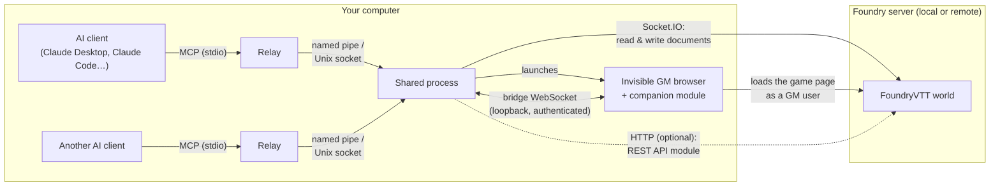

# FoundryVTT MCP Server

[](LICENSE)
[](https://nodejs.org/)
[](https://www.typescriptlang.org/)
[](https://vitest.dev/)
[](https://modelcontextprotocol.io/)

A comprehensive, production-grade [Model Context Protocol](https://modelcontextprotocol.io/) (MCP) server for **Foundry Virtual Tabletop (FoundryVTT)**.

This server empowers AI assistants (Claude Desktop, Claude Code, Oh My Pi, VS Code, Cursor, etc.) to act as fully capable, autonomous **Co-GMs and GM assistants** inside FoundryVTT. It provides complete read and write access across game mechanics, actors, items, tokens, combat encounters, canvas placeables (walls, lights, sounds, templates, drawings, notes, tiles), playlists, macros, roll tables, compendiums, world settings, and live canvas rendering.

---

## 🧭 How it works



Your AI assistant starts a small relay program for this server. Every relay, from one assistant or several, hands its requests to the same background process, which keeps a single connection to Foundry open. That process reads and changes the world through Foundry's normal connection, the one any player's browser uses. Some things only a real Foundry page can do: capturing the canvas, rolling dice with Foundry's own engine, reading compendium documents, uploading files, pausing the game. For those, the background process runs an invisible browser, sharing its own Foundry session, where the companion module runs. The module talks only to that process, and only after each has proven its identity to the other.

**Technical details:**

- **Live world cache**: on connect, the server loads the world over Socket.IO and keeps it in memory; every `modifyDocument` broadcast — from the AI's own writes or from any user in Foundry — updates it, so reads are instant and stay current. `refresh_world_data` forces a full reload.
- **Socket.IO connection**: authenticates as `FOUNDRY_USERNAME` (Assistant GM role recommended) and performs every write over Foundry's core `modifyDocument` protocol — only when `FOUNDRY_WRITE_ENABLED=true`. It is the only side that logs in: when Foundry forgets its session (server restart, world shut down) it logs in again by itself, retrying every 5 s at first and at most every 2 min, and tool calls made meanwhile wait up to 15 s before being refused with the reason.
- **Invisible GM session**: started when `FOUNDRY_MODULE_BRIDGE_ENABLED=true`. The shared process drives a background browser through `playwright-core`: Chrome, then Edge, then Playwright's own Chromium (`npx playwright install chromium`), or any Chromium-based browser set in `FOUNDRY_HEADLESS_GM_EXECUTABLE_PATH`. The page shares the Socket.IO connection's session — one account, one login — and never fills the `/join` form: Foundry keeps several connections per session, so neither ejects the other. The page stays on `/game` (a navigation elsewhere, such as **Log Out**, is blocked and the page reloads `/game`, because leaving would log the shared session out). A watchdog reloads the page if the module stays disconnected for about a minute. Advanced: `FOUNDRY_HEADLESS_GM_USERNAME` / `FOUNDRY_HEADLESS_GM_PASSWORD` naming another account give the page its own login instead. A human can meanwhile play as a normal **Player** in their own browser.
- **Companion module** (`foundryvtt-mcp-bridge`, 0.5.0 or later): runs only in that GM session and serves the bridge tools — `capture_scene` (canvas screenshot with a grid overlay), `roll_and_post` (native `Roll` chat cards), `get_document_schema`, `search_compendium_content` and compendium imports, `upload_asset` (FilePicker), `set_pause`, `ping_canvas`, `set_target` / `get_targets`. Without it these tools report unavailable; everything else keeps working. The bridge listens on loopback only and authenticates the module — see [Module Bridge Security](#module-bridge-security).
- **Optional REST API module**: with `FOUNDRY_API_KEY` set, the server also connects to the Foundry Local REST API module over HTTP. It backs the diagnostics tools (`get_health_status`, `get_system_health`, `get_recent_logs`, `search_logs`, `diagnose_errors`) and `search_compendium`, and some reads use it instead of the cache (actor and item search, actor details, scene and world info, `roll_dice`). Socket.IO stays the main connection and carries every write.
- **Shared process** (default): MCP clients may start several server instances — Claude Desktop starts several at launch — so each instance is only a lightweight relay, and the FoundryVTT connection, the bridge and the GM session live once, in a background process every relay shares. See [Shared Process Mode](#shared-process-mode); `FOUNDRY_MCP_SHARED=false` runs everything in one process instead.

---

## 🌟 Key Highlights & Capabilities (114 Tools)

- 👁️ **Real-Time Event Stream & Activity Log (`watch_events`)**: Zero-polling event awareness via Socket.IO `modifyDocument` and companion bridge pushes. An AI DM agent can long-poll on a cursor-addressed stream (`cursor`, `waitMs`, `excludeSelf`, `types`, `sceneId`) to react instantly when players chat, move tokens, advance combat, toggle doors, or select targets.
- 🎲 **Game Mechanics & Interactive Chat**: Roll dice with standard or complex drop/keep notation (`4d6kh3`, `1d20r1`). Roll and post interactive, clickable chat cards directly to the Foundry chat log via the companion bridge (`roll_and_post`).
- 🗺️ **Full Canvas & Spatial Control**: Create, inspect, update, and remove all canvas placeable types:
  - **Scene Regions (v12+)**: `create_region`, `delete_region`, `list_regions` with geometric shapes (`rectangle`, `circle`, `ellipse`, `polygon`) and automated trigger behaviors.
  - **Walls & Doors**: standard, doors (open/close/lock), secret doors, windows, ethereal walls, and custom coordinates (`create_wall`, `list_walls`, `set_door_state`).
  - **Ambient Lights**: coordinate or grid-cell placement, dim/bright radii, animation effects, color thresholds (`create_light`, `update_light`, `delete_light`, `list_lights`).
  - **Ambient Sounds**: audio tracks, radii, volume, repeat modes (`create_sound`, `delete_sound`, `list_sounds`).
  - **Measured Templates**: cone, circle, ray, and rect spell area-of-effect markers with directional rotation and colors (`create_template`, `delete_template`, `list_templates`).
  - **Drawings**: freehand and geometrical shapes, stroke/fill styling, and text annotations (`create_drawing`, `delete_drawing`, `list_drawings`).
  - **Map Notes & Pins**: landmark markers linked to journal entries or standalone labels (`create_note`, `delete_note`, `list_notes`).
  - **Tiles & Props**: place decorative tiles and backgrounds (`create_tile`, `delete_tile`, `list_tiles`).
  - **Canvas Viewport Capture**: screenshot the GM canvas viewport with a burned-in coordinate grid overlay (`[col,row]`) via `capture_scene`.
  - **Targeting & Animated Pings**: focus player attention with animated camera pings (`ping_canvas`) and view/set token targeting reticles (`set_target`, `get_targets`).
- 🧙 **Token & Actor Control**:
  - **A\* Pathfinding Movement**: tokens navigate around walls and automatically open closed doors along their path (`move_token_pathfind`).
  - **Token Vision & Lighting**: configure sight ranges, vision modes, dim/bright emitted light, and vision detection angles (`update_token_vision`).
  - **Generalized ActiveEffects**: create, update, delete, and inspect mechanical buffs/debuffs with attribute changes (`key`, `mode`, `value`, `priority`) and durations (`rounds`, `seconds`, `turns`) on top-level or synthetic unlinked token actors (`create_actor_effect`, `update_actor_effect`, `delete_actor_effect`, `list_actor_effects`).
  - **Status Conditions**: apply/remove system-agnostic status conditions (`apply_status_effect`).
  - **Compendium Actor & Item Import**: import entire NPC/monster documents from compendium packs with automatic per-item error recovery (`import_compendium_actor`), or import specific items into actor inventories (`create_actor_item`).
  - **System Attribute Mutations**: patch actor system data (HP, temporary HP, currency, resources, spell slots) using JSON merge patches (`update_actor_attributes`).
- ⚔️ **Combat Encounter Management**: Create encounters, seed combatants from tokens, manage initiative orders, advance turns/rounds, track active combatants, pause/unpause the game clock (`set_pause`), and end encounters.
- 📜 **World Documents & Organization**:
  - **Folders**: manage hierarchical folder structures for actors, items, journals, and scenes (`create_folder`, `list_folders`).
  - **Macros**: inspect, create, and delete script/chat macros (`create_macro`, `list_macros`, `delete_macro`).
  - **Playlists & Audio**: create multi-track playlists, control playback (play, pause, stop), and adjust track states (`create_playlist`, `set_playlist_state`, `list_playlists`).
  - **Roll Tables**: create tables with automatic sequential range distribution (`1dN`), and draw live results (`create_roll_table`, `roll_table`, `list_roll_tables`).
  - **Document Ownership & User Roles**: configure granular document permissions (`set_document_ownership`) and user roles with self-demotion lockout guards (`set_user_role`).
  - **World Settings**: safely inspect and update module and system settings with built-in protection against core engine corruption (`get_world_setting`, `set_world_setting`).
  - **Asset Uploads**: upload images, tokens, and audio directly into Foundry's `Data/` storage via native FilePicker or local filesystem (`upload_asset`).
- 🌫️ **Scene, Weather & Exploration Management**: Switch active scenes, adjust darkness levels, toggle global illumination, set environmental weather effects (`set_scene_weather`), and reset Fog of War exploration (`reset_fog`).
- 🔍 **Rules & Compendium Search**: Search world documents, compendium packs, and rule text with contextual snippets (`search_compendium_content`, `lookup_rule`).
---

## 🚀 Quick Start

### 1. Prerequisites

- **Node.js 18+** or **Bun**
- **FoundryVTT v13 or v14** running an active world (the versions the server handles explicitly; older versions are not verified)
- A dedicated Foundry user account with the **Assistant GM** role (Gamemaster works too, with the caveat below)
- **A Chromium-based browser installed** (for the automatic headless GM browser session — see below): Google Chrome or Microsoft Edge are detected automatically; any other Chromium browser (Brave, Vivaldi…) works through `FOUNDRY_HEADLESS_GM_EXECUTABLE_PATH`

### 2. Configure Dedicated Foundry User

In FoundryVTT:
1. Open **Configuration** → **User Management**
2. Click **Create User**
3. Set Username: `mcp-api`, Password: `mcp` (or your choice)
4. Role: **Assistant GM** (recommended). The invisible browser session runs as this account; as a Gamemaster it could become Foundry's *active GM* in place of a human Gamemaster (equal roles go to the smaller user id) and run the game system's automations. `status` and `get_health_status` warn about it. An Assistant GM cannot grant the Gamemaster role or change `core.permissions`: the server refuses those with a clear message.

> **Playing as a human while the AI GMs?** No extra setup needed. Log into your own Foundry client as a **Player** — or as your own **Gamemaster**: with `mcp-api` an Assistant GM, you stay the active GM. The server opens its own invisible background browser session with `mcp-api`'s session for GM-tier canvas access (screenshots, dice rolls, pausing, uploads); only `mcp-api` appears in the player list for it. The module bridge requires this session: a GM tab you open yourself never connects to it (see [Module Bridge Security](#module-bridge-security)).

### 3. Install the Companion Module (Recommended)

Copy the `foundry-module` folder from this repo to your FoundryVTT `Data/modules/` directory:

```bash
# Windows
cp -r foundry-module "%LOCALAPPDATA%/FoundryVTT/Data/modules/foundryvtt-mcp-bridge"

# macOS
cp -r foundry-module "~/Library/Application Support/FoundryVTT/Data/modules/foundryvtt-mcp-bridge"

# Linux
cp -r foundry-module "~/.local/share/FoundryVTT/Data/modules/foundryvtt-mcp-bridge"
```

In FoundryVTT, go to **Manage Modules** and enable **FoundryVTT MCP Bridge**.

---

## ⚙️ Configuration & Client Setup

### Environment Variables

| Variable | Required | Default | Description |
| :--- | :--- | :--- | :--- |
| `FOUNDRY_URL` | **Yes** | `http://localhost:30000` | FoundryVTT server URL |
| `FOUNDRY_USERNAME` | **Yes** | — | FoundryVTT user account name |
| `FOUNDRY_PASSWORD` | **Yes** | — | FoundryVTT user account password |
| `FOUNDRY_WRITE_ENABLED` | No | `false` | Enables game-state mutations (walls, actors, tokens, etc.) |
| `FOUNDRY_MODULE_BRIDGE_ENABLED` | No | `false` | Enables WebSocket bridge for canvas screenshots & chat rolls |
| `FOUNDRY_MODULE_BRIDGE_PORT` | No | `31415` | WebSocket port for the companion module bridge |
| `FOUNDRY_HEADLESS_GM_ENABLED` | No | `true` | Auto-launches an invisible GM-tier browser session to host the module bridge. Required for the bridge: with `false` the companion module never connects (manually opened GM tabs are not supported) and a warning is logged at startup |
| `FOUNDRY_HEADLESS_GM_USERNAME` | No | — | Advanced two-account mode: another account the headless session logs in as through `/join`. Unset (or equal to `FOUNDRY_USERNAME`), the session shares the connector's own session |
| `FOUNDRY_HEADLESS_GM_PASSWORD` | No | `FOUNDRY_PASSWORD` | Password of that other account (two-account mode only) |
| `FOUNDRY_HEADLESS_GM_EXECUTABLE_PATH` | No | — | Path to any Chromium-based browser binary (Chrome, Edge, Brave, Vivaldi…), skipping auto-detection |
| `FOUNDRY_DATA_PATH` | No | — | Local path to Foundry `Data/` for asset dimension discovery |
| `FOUNDRY_API_KEY` | No | — | Optional REST API key for server diagnostics tools |
| `FOUNDRY_EVENT_BUFFER_SIZE` | No | `500` | In-memory event log ring buffer capacity |
| `FOUNDRY_EVENT_WAIT_MS` | No | `25000` | Default long-polling timeout for `watch_events` |
| `LOG_LEVEL` | No | `info` | Logging verbosity (`debug`, `info`, `warn`, `error`) |
| `FOUNDRY_MCP_SHARED` | No | `true` | Shared-process mode; `false` makes every instance own its own connection, bridge and browser (all-in-one) |
| `FOUNDRY_MCP_IDLE_TIMEOUT_MINUTES` | No | `30` | Minutes the shared process stays up with **no relay connected** before exiting; `0` = never |
| `FOUNDRY_MCP_STATE_DIR` | No | see below | Directory for the shared process's token, state file and logs; a non-default directory also gets its own pipe (an isolated shared process) |

#### Choosing the Headless GM Browser

Without `FOUNDRY_HEADLESS_GM_EXECUTABLE_PATH`, the server tries Google Chrome, then Microsoft Edge, then Playwright's own Chromium (only present after `npx playwright install chromium`). To use another Chromium-based browser such as Brave or Vivaldi, point the variable at its executable. In a JSON client configuration, Windows backslashes must be doubled:

```json
"env": {
  "FOUNDRY_HEADLESS_GM_EXECUTABLE_PATH": "C:\\Program Files\\BraveSoftware\\Brave-Browser\\Application\\brave.exe"
}
```

Forward slashes (`C:/Program Files/...`) also work and need no escaping. The headless browser is launched with Chromium's local network access checks disabled so the module can reach `ws://localhost` from the Foundry page — see [TROUBLESHOOTING.md](TROUBLESHOOTING.md#module-bridge-never-connects--websocket--failed).

### Shared Process Mode

By default `node dist/index.js` is a **relay**: it answers `initialize` and `tools/list` immediately and forwards `tools/call` and `resources/read` to a **shared process** (`node dist/index.js daemon`) that holds the FoundryVTT connection, the module bridge and the headless GM session.

- **Automatic start**: the first relay that finds no shared process starts one in the background (detached, so it survives the client closing or restarting the relay) and waits for it — up to ~30 s. Relays started at the same time end up sharing a single process. Relays connect as soon as they start, so the FoundryVTT connection and the GM session are ready before the first tool call.
- **Lifetime**: the shared process stays up while at least one relay is connected, however long it goes without calls. It exits after `FOUNDRY_MCP_IDLE_TIMEOUT_MINUTES` with no relay connected, on `stop`, or when a relay with a different version (a rebuild counts) or configuration connects — it then lets running calls finish and the relay starts a fresh one. A call that was already running always completes, even if the client that asked for it went away.
- **FoundryVTT not reachable yet**: the shared process stays up, returns the connection error to the call, and retries on the next call — start FoundryVTT before or after your AI client, in any order. With FoundryVTT up but no world launched, it retries by itself in the background (every 5 s at first, at most every 2 min) and connects as soon as the world is launched.
- **Writes**: tools that change game state run one at a time, in arrival order; reads run in parallel.
- **Commands**:

  ```bash
  node dist/index.js status   # pid, version, uptime, FoundryVTT / bridge / GM session state, relays, log path
  node dist/index.js stop     # finish running calls, then stop the shared process
  ```

  They only read the state directory, so they work from any terminal — no FoundryVTT configuration needed.
- **State directory**: `%LOCALAPPDATA%\foundryvtt-mcp\` on Windows, `$XDG_STATE_HOME/foundryvtt-mcp/` (or `~/.local/state/foundryvtt-mcp/`) elsewhere. It holds the access token relays must present (`token`), the state file (`daemon.json`) and the logs (`daemon.log`, `relay.log`, rotated at 5 MB × 3). Relays reach the shared process through the named pipe `\\.\pipe\foundryvtt-mcp-<user>` (Windows) or a Unix socket in the state directory.
- **One configuration for every client**: the shared process runs with the configuration of the relay that started it. If two clients (say Claude Desktop and Claude Code) pass different settings, each one restarts the shared process with its own — use the same `env` block everywhere, or set `FOUNDRY_MCP_SHARED=false` for one of them (only one process can own the bridge port).
- **Configuration source**: Claude Desktop starts MCP servers with `C:\Windows\System32` as working directory, where no `.env` file is looked up — put the configuration in the `env` block of the client configuration. The shared process inherits the environment and working directory of the relay that starts it.
- **Module bridge**: listens on loopback only (`127.0.0.1` and `::1`); the module reaches it at `ws://localhost:<port>` from the headless browser on the same machine, and authenticates — see [Module Bridge Security](#module-bridge-security).

### Module Bridge Security

The bridge drives a GM session, and its loopback port is reachable by every local process and every page open in a local browser. So the server and the companion module (0.5.0 or later) authenticate each other, with nothing to configure:

- **Origin**: the WebSocket upgrade is refused (HTTP 403) unless its `Origin` header is the origin of `FOUNDRY_URL` — a page from another site cannot open the socket.
- **Mutual handshake (protocol v1)**: the server sends a random challenge; the module answers with an HMAC-SHA256 proof, and the server answers with its own proof, which the module checks before obeying. Both are keyed by a random secret the shared process generates at startup and keeps in memory only — never written to disk, logged or returned by a tool. The headless GM session exposes a `window.foundryMcpBridge` function to its page (a Playwright binding) that computes the proofs, so the secret never enters the page or the WebSocket. It disappears with the shared process.
- **Until authenticated**, a connection receives no command, nothing it sends is processed, and it cannot displace the connected module. It is closed with `4401` (wrong proof, unknown protocol, any other message), `4408` (no answer within 5 s — typically a module older than 0.5.0, logged as such) or `1009` (a message over 4 KiB). Refusals are logged as warnings (rate-limited); `status` and `get_health_status` show whether an authenticated module is connected.
- **No manual GM tab**: a GM tab opened by hand has no `window.foundryMcpBridge`, so the module logs `no foundryvtt-mcp credentials in this browser, bridge disabled` to the browser console and stays silent. `FOUNDRY_HEADLESS_GM_ENABLED=false` therefore disables the bridge in practice.
- **Check it**: with the connector running and the module connected, `npm run check:bridge-security` tries four forged connections and confirms each is refused while the module stays connected.

### Claude Desktop Configuration

Add to `claude_desktop_config.json`:

```json
{
  "mcpServers": {
    "foundryvtt": {
      "command": "node",
      "args": ["<PATH_TO_REPO>/dist/index.js"],
      "env": {
        "FOUNDRY_URL": "http://localhost:30000",
        "FOUNDRY_USERNAME": "mcp-api",
        "FOUNDRY_PASSWORD": "mcp",
        "FOUNDRY_WRITE_ENABLED": "true",
        "FOUNDRY_MODULE_BRIDGE_ENABLED": "true",
        "FOUNDRY_MODULE_BRIDGE_PORT": "31415"
      }
    }
  }
}
```

### Oh My Pi Configuration

Add to `~/.omp/agent/mcp.json` (or `~/.omp/mcp.json`):

```json
{
  "mcpServers": {
    "foundryvtt": {
      "type": "stdio",
      "command": "node",
      "args": ["<PATH_TO_REPO>/dist/index.js"],
      "env": {
        "FOUNDRY_URL": "http://localhost:30000",
        "FOUNDRY_USERNAME": "mcp-api",
        "FOUNDRY_PASSWORD": "mcp",
        "FOUNDRY_WRITE_ENABLED": "true",
        "FOUNDRY_MODULE_BRIDGE_ENABLED": "true",
        "FOUNDRY_MODULE_BRIDGE_PORT": "31415"
      },
      "timeout": 60000
    }
  }
}
```

---

## 🛠️ Tool Catalog (114 Tools)

### 1. Real-Time Event Awareness
- `watch_events` — long-poll a cursor-addressed activity log (`cursor`, `waitMs`, `limit`, `kinds`, `types`, `actions`, `sceneId`, `excludeSelf`) capturing document broadcasts and canvas activity without polling.

### 2. Canvas & Spatial Placeables
- `create_region` / `delete_region` / `list_regions` — manage Scene Regions (v12+) with geometric shapes (`rectangle`, `circle`, `ellipse`, `polygon`) and automated behaviors.
- `create_wall` / `delete_wall` / `list_walls` / `set_door_state` — complete wall and door geometry management.
- `create_light` / `update_light` / `delete_light` / `list_lights` — ambient lighting control (radii, colors, animations).
- `create_sound` / `delete_sound` / `list_sounds` — ambient audio placement on canvas scenes.
- `create_template` / `delete_template` / `list_templates` — spell and effect area-of-effect templates.
- `create_drawing` / `delete_drawing` / `list_drawings` — map shapes, zones, and text annotations.
- `create_note` / `delete_note` / `list_notes` — map pins and landmark markers.
- `create_tile` / `delete_tile` / `list_tiles` — decorative tiles and map props.
- `capture_scene` — screenshot the active scene canvas with a grid coordinate overlay burned in.
- `ping_canvas` — emit an animated canvas ping at specific pixel coordinates.
- `find_open_cells` — scan scenes for unblocked grid cells suitable for token/prop placement.
- `list_scene_assets` — discover map backgrounds, token art, and audio files with parsed tags and dimensions.
- `upload_asset` — upload image/audio files into Foundry's `Data/` directory via FilePicker or local filesystem.

### 3. Tokens & Movement
- `spawn_token` — place actor tokens on scenes with custom size, elevation, and coordinates.
- `delete_token` — remove tokens from scenes without deleting the underlying actor.
- `list_tokens` — list placed tokens on active or specific scenes.
- `move_token` — teleport a token to exact pixel coordinates.
- `move_token_pathfind` — move tokens using A* obstacle avoidance around walls with automatic door opening.
- `move_tokens` — batch move multiple tokens simultaneously.
- `set_target` / `get_targets` — set and inspect token targeting reticles across connected users.
- `update_token_vision` — configure vision ranges, vision modes, dim/bright emitted lights, and angles.
- `apply_status_effect` — toggle simple status conditions (`prone`, `stunned`, `blinded`, `invisible`, etc.).

### 4. Actors & Inventory
- `create_world_actor` / `create_full_actor` / `delete_world_actor` — create and delete actor documents.
- `import_compendium_actor` — import entire NPCs/monsters from compendium packs with embedded items and automatic error recovery.
- `search_actors` — query actors by name and type with cursor pagination support.
- `get_actor_details` — retrieve actor system data, statistics, attributes, and health.
- `update_actor_attributes` — patch nested system data using dot paths (`attributes.hp.value`, `currency.gp`).
- `get_actor_inventory` — list owned items with full system properties.
- `search_items` — search world item documents by name, optionally filtered by type (world items, not owned items).
- `create_actor_item` — create inline items OR import directly from compendium packs (`source: { type: 'compendium', compendiumId, itemId }`).
- `update_actor_item` — apply JSON merge patches to owned items.
- `delete_actor_item` — delete specific items from actor inventories.
- `create_actor_effect` / `update_actor_effect` / `delete_actor_effect` / `list_actor_effects` — general-purpose ActiveEffects with mechanical changes (`key`, `mode`, `value`, `priority`) and durations on top-level or synthetic unlinked token actors.

### 5. Combat Encounters
- `start_combat` — create encounters and seed combatants from scene tokens.
- `get_combat_state` — retrieve combatant turn order, HP, AC, and round number.
- `set_initiative` — set combatant initiative values and re-order turns.
- `next_turn` — advance the turn tracker (handles round increments and skips defeated combatants).
- `set_pause` — pause or unpause the game clock.
- `end_combat` — terminate active encounters.

### 6. World Documents & Organization
- `list_folders` / `create_folder` — organize actors, items, journals, and scenes in nested folders.
- `list_macros` / `create_macro` / `delete_macro` — manage script and chat macro documents.
- `list_playlists` / `create_playlist` / `set_playlist_state` / `delete_playlist` — audio playlist and sound controls.
- `create_roll_table` / `delete_roll_table` / `roll_table` / `list_roll_tables` — table creation and result rolling.
- `get_world_setting` / `set_world_setting` — inspect and modify system/module settings with core protection.
- `set_document_ownership` — configure granular document permissions (`none`, `limited`, `observer`, `owner`).
- `get_world_summary` — world metadata (title, game system, core version) and per-collection document counts.
- `search_world` — search actors, items, scenes, and journals by name at once, grouped by collection.
- `get_users` / `set_user_role` — list connected users and change permission roles with self-demotion lockout guards.
- `create_journal_entry` / `get_journal` / `search_journals` / `delete_journal_entry` — manage session notes and lore. `get_journal` lists each page's id; pass `raw: true` for the full, unmodified page HTML.
- `update_journal_page` / `add_journal_page` / `update_journal_entry` — edit existing journals: replace or append to a page's content (or rename it), add a page after the last one, and rename, refile, or change the visibility of an entry. Page writes work on the page as stored on the server, never on the cache: an append is added to the current text, and a replace needs the `version` token printed by `get_journal` `raw: true` and is refused if the page changed since. Every write keeps a local copy of the previous text, returns the new version token, and the page is watched for a later overwrite (a stale save, or an open FoundryVTT editor's autosave) — see [TROUBLESHOOTING.md](TROUBLESHOOTING.md#a-journal-edit-was-overwritten).

### 7. Scene, Weather & Exploration
- `create_scene` / `delete_scene` / `get_scene_info` / `switch_scene` — scene creation and player activation.
- `set_scene_weather` — set or clear weather effects (`rain`, `snow`, `fog`, `""`).
- `set_scene_lighting` — ambient darkness levels and global illumination settings.
- `reset_fog` — reset Fog of War exploration on active scenes.

### 8. Game Mechanics & Bridge Tools
- `roll_dice` — local mathematical dice formula evaluation.
- `roll_and_post` — evaluates formulas via Foundry's native engine and posts interactive chat cards.
- `lookup_rule` — search world journals and system compendium packs for rules with snippet previews.
- `get_document_schema` — introspect game system DataModel schemas for actor and item types.
- `search_compendium` — search compendium packs by name and metadata, across all enabled packs or one pack (requires the REST API module; returns no results without it).
- `search_compendium_content` — deep search inside compendium pack documents and journal pages.
- `send_chat_message` / `get_chat_messages` — post and read messages from the Foundry chat log.
- `generate_npc` / `generate_loot` — instant procedural generators.

### 9. Diagnostics & Logging
- `get_health_status` / `get_system_health` — connection and server health metrics.
- `get_recent_logs` / `search_logs` — inspect server logs and error stack traces.
- `diagnose_errors` — analyze recent errors into prioritized resolution suggestions.
- `refresh_world_data` — force a re-fetch of the cached world state snapshot.

## 🧪 Development & Testing

```bash
# Install dependencies
npm install

# Compile TypeScript
npm run build

# Run complete unit test suite (1066 tests)
npm test

# Run linter and formatting checks
npm run lint

# Start server in development watch mode
npm run dev
```

---

## 📄 License

This project is licensed under the [MIT License](LICENSE).
