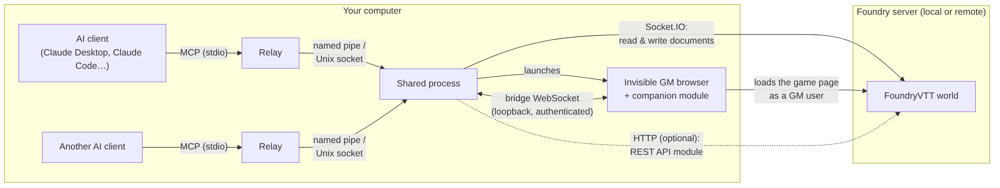

# FoundryVTT MCP Server

[](https://github.com/G33ks/foundryvtt-mcp/actions/workflows/test.yml)
[](https://github.com/G33ks/foundryvtt-mcp/actions/workflows/security.yml)
[](https://www.npmjs.com/package/@g33ks/foundryvtt-mcp)
[](https://github.com/G33ks/foundryvtt-mcp/blob/main/LICENSE)

A [Model Context Protocol](https://modelcontextprotocol.io/) (MCP) server that lets an AI assistant such as Claude read and run a **Foundry Virtual Tabletop** world with you: look things up, keep notes, place tokens and scenery, run combat, roll dice. It works with any game system, through FoundryVTT's own documents.

## How it works



Your AI client starts a small relay program. Every relay hands its requests to one background process, which logs in to FoundryVTT with an account of its own, the way a player's browser does, and keeps the world in memory. For what only a real FoundryVTT page can do (capturing the canvas, native dice rolls, compendium documents, uploads), that process runs an invisible browser where the companion module **FoundryVTT MCP Bridge** connects to it. Details: [Architecture](https://github.com/G33ks/foundryvtt-mcp/blob/main/docs/architecture.md).

## What it does

More than a hundred tools, in these groups ([full list](https://github.com/G33ks/foundryvtt-mcp/blob/main/docs/tools.md)):

- **Actors and items**: search, details, inventory, attribute changes, owned items, active effects, on a world actor or on one token.
- **Tokens**: place, move (with pathfinding around walls), remove, vision, status conditions.
- **Scenes**: create, activate, lighting, weather, fog of war.
- **Canvas**: walls and doors, lights, sounds, map notes, drawings, templates, regions, tiles, free cells, the images and sounds available.
- **Combat**: start, initiative, turns, end, current state.
- **Journals**: search, read, create, and edit pages safely (version check, local copies, overwrite detection).
- **Chat and dice**: read and send messages; roll dice, with FoundryVTT's own engine when the REST API module's key is set and locally otherwise.
- **World**: summary and search, folders, macros, playlists, roll tables, users and roles, ownership, settings.
- **Compendiums, rules and generators**: compendium search, rule lookup in journals and compendiums, quick NPC and loot generators.
- **Companion module**: canvas capture, rolls posted to chat by FoundryVTT, document schemas, compendium content and imports, an actor's prepared data, targets, pings, pause, file uploads.
- **Events and diagnostics**: a live activity log to follow the game, the connector's health, server logs.

Writes are off until you allow them; while they are off, every tool that changes the world is refused. See [Security](https://github.com/G33ks/foundryvtt-mcp/blob/main/docs/security.md).

## Requirements

- **Node.js 22 or newer**, with npm.
- **FoundryVTT v13 or v14** with a world you can open as its Gamemaster, on this computer or on a server (v14 tried: see [Compatibility](https://github.com/G33ks/foundryvtt-mcp/blob/main/docs/compatibility.md)).
- **A Chromium-based browser** on this computer: Google Chrome, Microsoft Edge, Brave, Vivaldi or Chromium. You never see it open.
- **An MCP client**: Claude desktop or Claude Code (others that start servers over stdio should work).

## Quick start

### 1. Install the companion module, create the connector's account

1. On FoundryVTT's **Setup** screen: **Add-on Modules** → **Install Module**, paste this **Manifest URL**, then **Install**:

   ```
   https://raw.githubusercontent.com/G33ks/foundryvtt-mcp/main/foundry-module/module.json
   ```

2. Launch your world as its Gamemaster. **Game Settings** → **User Management** → **Create Additional User**: name it `mcp-api`, give it a long password used nowhere else and the **Assistant GM** role.
3. **Game Settings** → **Manage Modules**: check **FoundryVTT MCP Bridge**, then **Save Module Settings**.

### 2. Install the connector

```bash
npm install -g @g33ks/foundryvtt-mcp
foundryvtt-mcp --version
```

In Windows PowerShell, if `npm` is refused (*running scripts is disabled*), type `npm.cmd`. The package is `@g33ks/foundryvtt-mcp`, not the unscoped `foundryvtt-mcp`.

### 3. Run `init`

```bash
foundryvtt-mcp init
```

It asks for FoundryVTT's address (the one you open in your browser), the account from step 1 and whether the AI may change the world (no by default). It checks each answer against your FoundryVTT, writes the configuration file, and prints what to give your MCP client.

### 4. Add the connector to your MCP client

- **Claude desktop**: **Settings** → **Developer** → **Edit Config**, add the `foundryvtt` entry `init` printed under `"mcpServers"`, save, then quit Claude desktop completely (also from the notification area or menu bar) and start it again.
- **Claude Code**: run the `claude mcp add foundryvtt …` command `init` printed, then start a new session.

### 5. First try

1. `foundryvtt-mcp init --check` should end with `All checks passed.`
2. Ask your AI client: *"Show the FoundryVTT connector's health status."* It should show the FoundryVTT connection, the module bridge and the GM session connected. The first call can take a few seconds.

When something fails, the message says why; [TROUBLESHOOTING.md](https://github.com/G33ks/foundryvtt-mcp/blob/main/TROUBLESHOOTING.md) explains each one. Every step in detail, updates and uninstalling: [Installation](https://github.com/G33ks/foundryvtt-mcp/blob/main/docs/installation.md).

## Known limitations

- **Close a journal page in FoundryVTT before the AI writes to it.** An open editor's autosave can overwrite the AI's change; the connector detects it and keeps a copy, but cannot prevent it.
- **Write stored fields only.** A value the game system computes is accepted and saved, but has no effect in play; `get_document_schema` tells them apart.
- **`search_compendium` needs the separate REST API module.** Without it, use `search_compendium_content`, which goes through the companion module.
- **`watch_events` does not see the connector's own changes**, only those of other users.
- **One connector per computer**: two would compete for the companion module's port.
- **Some changes stay yours**: the connector does not promote anyone to Gamemaster nor change the world's permission settings.
- **After an update, restart your MCP client**: a client started earlier keeps the previous list of tools.

## Documentation

- [Installation](https://github.com/G33ks/foundryvtt-mcp/blob/main/docs/installation.md): every step, other clients, updating, uninstalling.
- [Configuration](https://github.com/G33ks/foundryvtt-mcp/blob/main/docs/configuration.md): the configuration file and every setting.
- [Tools](https://github.com/G33ks/foundryvtt-mcp/blob/main/docs/tools.md): every tool, what it needs, whether it writes.
- [Architecture](https://github.com/G33ks/foundryvtt-mcp/blob/main/docs/architecture.md): relays, the shared process, the invisible session, the bridge.
- [Security](https://github.com/G33ks/foundryvtt-mcp/blob/main/docs/security.md): what the connector can do and keeps, and how to limit it.
- [Compatibility](https://github.com/G33ks/foundryvtt-mcp/blob/main/docs/compatibility.md): FoundryVTT versions, hosting, clients, game systems.
- [Troubleshooting](https://github.com/G33ks/foundryvtt-mcp/blob/main/TROUBLESHOOTING.md) and the [changelog](https://github.com/G33ks/foundryvtt-mcp/blob/main/CHANGELOG.md).

## Contributing and support

- Questions: [GitHub Discussions](https://github.com/G33ks/foundryvtt-mcp/discussions). Bugs and requests: [issues](https://github.com/G33ks/foundryvtt-mcp/issues/new/choose).
- Working on the code: [CONTRIBUTING.md](https://github.com/G33ks/foundryvtt-mcp/blob/main/CONTRIBUTING.md).
- Vulnerabilities: privately, as [SECURITY.md](https://github.com/G33ks/foundryvtt-mcp/blob/main/SECURITY.md) describes.
- [Code of Conduct](https://github.com/G33ks/foundryvtt-mcp/blob/main/CODE_OF_CONDUCT.md).

## Origins

Started by Lauri Gates as [laurigates/foundryvtt-mcp](https://github.com/laurigates/foundryvtt-mcp), continued in [RN0000/foundryvtt-mcp](https://github.com/RN0000/foundryvtt-mcp), then forked as [duckpuppy/foundryvtt-mcp](https://github.com/duckpuppy/foundryvtt-mcp), from which this repository was forked; it now continues independently. Thanks to everyone who built the earlier versions; their work is kept in the history and in the changelog.

## License

[MIT](https://github.com/G33ks/foundryvtt-mcp/blob/main/LICENSE).
