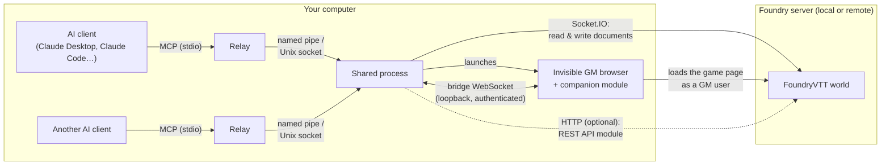

# FoundryVTT MCP Server

[](LICENSE)
[](https://nodejs.org/)
[](https://www.typescriptlang.org/)
[](https://vitest.dev/)
[](https://modelcontextprotocol.io/)

A comprehensive, production-grade [Model Context Protocol](https://modelcontextprotocol.io/) (MCP) server for **Foundry Virtual Tabletop (FoundryVTT)**.

This server empowers AI assistants (Claude Desktop, Claude Code, Oh My Pi, VS Code, Cursor, etc.) to act as fully capable, autonomous **Co-GMs and GM assistants** inside FoundryVTT. It provides complete read and write access across game mechanics, actors, items, tokens, combat encounters, canvas placeables (walls, lights, sounds, templates, drawings, notes, tiles), playlists, macros, roll tables, compendiums, world settings, and live canvas rendering.

---

## 🧭 How it works



Your AI assistant starts a small relay program for this server. Every relay, from one assistant or several, hands its requests to the same background process, which keeps a single connection to Foundry open. That process reads and changes the world through Foundry's normal connection, the one any player's browser uses. Some things only a real Foundry page can do: capturing the canvas, rolling dice with Foundry's own engine, reading compendium documents, uploading files, pausing the game. For those, the background process runs an invisible browser, sharing its own Foundry session, where the companion module runs. The module talks only to that process, and only after each has proven its identity to the other.

**Technical details:**

- **Live world cache**: on connect, the server loads the world over Socket.IO and keeps it in memory; every `modifyDocument` broadcast — from the AI's own writes or from any user in Foundry — updates it, so reads are instant and stay current. `refresh_world_data` forces a full reload.
- **Socket.IO connection**: authenticates as `FOUNDRY_USERNAME` (Assistant GM role recommended) and performs every write over Foundry's core `modifyDocument` protocol — only when `FOUNDRY_WRITE_ENABLED=true`. It is the only side that logs in: when Foundry forgets its session (server restart, world shut down) it logs in again by itself, retrying every 5 s at first and at most every 2 min, and tool calls made meanwhile wait up to 15 s before being refused with the reason.
- **Invisible GM session**: started when `FOUNDRY_MODULE_BRIDGE_ENABLED=true`. The shared process drives a background browser through `playwright-core`: the first one found among Chrome, Edge, Brave, Vivaldi, a system Chromium and Playwright's own Chromium (`npx playwright install chromium`), or the Chromium-based browser set in `FOUNDRY_HEADLESS_GM_EXECUTABLE_PATH`. The page shares the Socket.IO connection's session — one account, one login — and never fills the `/join` form: Foundry keeps several connections per session, so neither ejects the other. The page stays on `/game` (a navigation elsewhere, such as **Log Out**, is blocked and the page reloads `/game`, because leaving would log the shared session out). A watchdog reloads the page if the module stays disconnected for about a minute. Advanced: `FOUNDRY_HEADLESS_GM_USERNAME` / `FOUNDRY_HEADLESS_GM_PASSWORD` naming another account give the page its own login instead. A human can meanwhile play as a normal **Player** in their own browser.
- **Companion module** (`foundryvtt-mcp-bridge`, 0.5.0 or later): runs only in that GM session and serves the bridge tools — `capture_scene` (canvas screenshot with a grid overlay), `roll_and_post` (native `Roll` chat cards), `get_document_schema`, `search_compendium_content` and compendium imports, `upload_asset` (FilePicker), `set_pause`, `ping_canvas`, `set_target` / `get_targets`. Without it these tools report unavailable; everything else keeps working. The bridge listens on loopback only and authenticates the module — see [Module Bridge Security](#module-bridge-security).
- **Optional REST API module**: with `FOUNDRY_API_KEY` set, the server also connects to the Foundry Local REST API module over HTTP. It backs the diagnostics tools (`get_health_status`, `get_system_health`, `get_recent_logs`, `search_logs`, `diagnose_errors`) and `search_compendium`, and some reads use it instead of the cache (actor and item search, actor details, scene and world info, `roll_dice`). Socket.IO stays the main connection and carries every write.
- **Shared process** (default): MCP clients may start several server instances — Claude Desktop starts several at launch — so each instance is only a lightweight relay, and the FoundryVTT connection, the bridge and the GM session live once, in a background process every relay shares. See [Shared Process Mode](#shared-process-mode); `FOUNDRY_MCP_SHARED=false` runs everything in one process instead.

---

## 🌟 Key Highlights & Capabilities (114 Tools)

- 👁️ **Real-Time Event Stream & Activity Log (`watch_events`)**: Zero-polling event awareness via Socket.IO `modifyDocument` and companion bridge pushes. An AI DM agent can long-poll on a cursor-addressed stream (`cursor`, `waitMs`, `excludeSelf`, `types`, `sceneId`) to react instantly when players chat, move tokens, advance combat, toggle doors, or select targets.
- 🎲 **Game Mechanics & Interactive Chat**: Roll dice with standard or complex drop/keep notation (`4d6kh3`, `1d20r1`). Roll and post interactive, clickable chat cards directly to the Foundry chat log via the companion bridge (`roll_and_post`).
- 🗺️ **Full Canvas & Spatial Control**: Create, inspect, update, and remove all canvas placeable types:
  - **Scene Regions (v12+)**: `create_region`, `delete_region`, `list_regions` with geometric shapes (`rectangle`, `circle`, `ellipse`, `polygon`) and automated trigger behaviors.
  - **Walls & Doors**: standard, doors (open/close/lock), secret doors, windows, ethereal walls, and custom coordinates (`create_wall`, `list_walls`, `set_door_state`).
  - **Ambient Lights**: coordinate or grid-cell placement, dim/bright radii, animation effects, color thresholds (`create_light`, `update_light`, `delete_light`, `list_lights`).
  - **Ambient Sounds**: audio tracks, radii, volume, repeat modes (`create_sound`, `delete_sound`, `list_sounds`).
  - **Measured Templates**: cone, circle, ray, and rect spell area-of-effect markers with directional rotation and colors (`create_template`, `delete_template`, `list_templates`).
  - **Drawings**: freehand and geometrical shapes, stroke/fill styling, and text annotations (`create_drawing`, `delete_drawing`, `list_drawings`).
  - **Map Notes & Pins**: landmark markers linked to journal entries or standalone labels (`create_note`, `delete_note`, `list_notes`).
  - **Tiles & Props**: place decorative tiles and backgrounds (`create_tile`, `delete_tile`, `list_tiles`).
  - **Canvas Viewport Capture**: screenshot the GM canvas viewport with a burned-in coordinate grid overlay (`[col,row]`) via `capture_scene`.
  - **Targeting & Animated Pings**: focus player attention with animated camera pings (`ping_canvas`) and view/set token targeting reticles (`set_target`, `get_targets`).
- 🧙 **Token & Actor Control**:
  - **A\* Pathfinding Movement**: tokens navigate around walls and automatically open closed doors along their path (`move_token_pathfind`).
  - **Token Vision & Lighting**: configure sight ranges, vision modes, dim/bright emitted light, and vision detection angles (`update_token_vision`).
  - **Generalized ActiveEffects**: create, update, delete, and inspect mechanical buffs/debuffs with attribute changes (`key`, `mode`, `value`, `priority`) and durations (`rounds`, `seconds`, `turns`) on top-level or synthetic unlinked token actors (`create_actor_effect`, `update_actor_effect`, `delete_actor_effect`, `list_actor_effects`).
  - **Status Conditions**: apply/remove system-agnostic status conditions (`apply_status_effect`).
  - **Compendium Actor & Item Import**: import entire NPC/monster documents from compendium packs with automatic per-item error recovery (`import_compendium_actor`), or import specific items into actor inventories (`create_actor_item`).
  - **System Attribute Mutations**: patch actor system data (HP, temporary HP, currency, resources, spell slots) using JSON merge patches (`update_actor_attributes`).
- ⚔️ **Combat Encounter Management**: Create encounters, seed combatants from tokens, manage initiative orders, advance turns/rounds, track active combatants, pause/unpause the game clock (`set_pause`), and end encounters.
- 📜 **World Documents & Organization**:
  - **Folders**: manage hierarchical folder structures for actors, items, journals, and scenes (`create_folder`, `list_folders`).
  - **Macros**: inspect, create, and delete script/chat macros (`create_macro`, `list_macros`, `delete_macro`).
  - **Playlists & Audio**: create multi-track playlists, control playback (play, pause, stop), and adjust track states (`create_playlist`, `set_playlist_state`, `list_playlists`).
  - **Roll Tables**: create tables with automatic sequential range distribution (`1dN`), and draw live results (`create_roll_table`, `roll_table`, `list_roll_tables`).
  - **Document Ownership & User Roles**: configure granular document permissions (`set_document_ownership`) and user roles with self-demotion lockout guards (`set_user_role`).
  - **World Settings**: safely inspect and update module and system settings with built-in protection against core engine corruption (`get_world_setting`, `set_world_setting`).
  - **Asset Uploads**: upload images, tokens, and audio directly into Foundry's `Data/` storage via native FilePicker or local filesystem (`upload_asset`).
- 🌫️ **Scene, Weather & Exploration Management**: Switch active scenes, adjust darkness levels, toggle global illumination, set environmental weather effects (`set_scene_weather`), and reset Fog of War exploration (`reset_fog`).
- 🔍 **Rules & Compendium Search**: Search world documents, compendium packs, and rule text with contextual snippets (`search_compendium_content`, `lookup_rule`).
---

## 🚀 Quick Start

Seven steps, in this order. [SETUP_GUIDE.md](SETUP_GUIDE.md) gives the details of each one; [TROUBLESHOOTING.md](TROUBLESHOOTING.md) helps when a step fails.

### 1. Check the prerequisites

- **Node.js 22 or newer** (current LTS recommended) — `node --version` shows yours. Download it from [nodejs.org](https://nodejs.org/).
- **Git**, to download the server.
- **FoundryVTT v13 or v14**, with a world you can open as its Gamemaster. Foundry may run on this computer or on a server.
- **A Chromium-based browser** on this computer: Google Chrome, Microsoft Edge, Brave, Vivaldi or Chromium. The server finds it by itself; you will never see it open.
- **Claude desktop** or **Claude Code**.

### 2. Create a dedicated user in Foundry

Launch your world and log in as its Gamemaster, then:

1. Open **Game Settings** → **User Management**.
2. Click **Create User**.
3. Name it `mcp-api` (or any name) and give it a **long password used nowhere else**.
4. Set its role to **Assistant GM**, then save.

This one account is all the server needs. Prefer **Assistant GM** to **Gamemaster**: as a Gamemaster, the server's invisible session could take the *active GM* role from you — see [SETUP_GUIDE.md](SETUP_GUIDE.md#2-set-up-a-dedicated-foundry-user).

### 3. Install the companion module, then enable it

The module is installed from Foundry's **Setup** screen (in the world: **Game Settings** → **Return to Setup**).

1. Open **Add-on Modules** → **Install Module**.
2. Paste this URL into the **Manifest URL** field at the bottom, then click **Install**:

   ```
   https://raw.githubusercontent.com/G33ks/foundryvtt-mcp/main/foundry-module/module.json
   ```

3. Launch your world again, log in as its Gamemaster, open **Game Settings** → **Manage Modules**, check **FoundryVTT MCP Bridge** and click **Save Module Settings**.

Updates and the manual copy: see [SETUP_GUIDE.md](SETUP_GUIDE.md#3-install-companion-module-foundryvtt-mcp-bridge).

### 4. Download and build the server

In a terminal (PowerShell, Terminal on macOS, any shell on Linux), in the folder where you want the server:

```bash
git clone https://github.com/G33ks/foundryvtt-mcp.git
cd foundryvtt-mcp
npm ci
npm run build
```

Keep this terminal open in the `foundryvtt-mcp` folder for the next steps.

### 5. Run `init`

```bash
node dist/index.js init
```

It asks for Foundry's address, the account from step 2 and whether the assistant may change the game (no by default), checking each answer against your Foundry: world running, account role, module enabled, browser. Then it writes the [configuration file](#configuration-file), the only place your settings live, and prints what to give your AI client. Details: [SETUP_GUIDE.md](SETUP_GUIDE.md#5-run-init).

### 6. Add the server to Claude

Use what `init` printed at the end:

- **Claude desktop**: **Settings** → **Developer** → **Edit Config** opens `claude_desktop_config.json`. Add the `foundryvtt` entry printed by `init` under `"mcpServers"` (keep any entries already there), save, then **quit Claude desktop completely** (also from the notification area or menu bar) and start it again.
- **Claude Code**: run the `claude mcp add foundryvtt …` command printed by `init` in a terminal, then start a new Claude Code session.

No `env` block is needed: the settings are in the configuration file.

### 7. Check that it works

1. In the terminal: `node dist/index.js init --check`. It should end with `All checks passed.`; a ✖ line says what to fix.
2. In Claude, ask: *"Show the FoundryVTT connector's health status."* Claude calls `get_health_status`, which should show the FoundryVTT connection ✅, the module bridge ✅ connected with an authenticated module, the headless GM session logged in with its browser, and the configuration file the settings come from.

The first call can take a few seconds while the server connects. If something is ❌, the message says why; see [TROUBLESHOOTING.md](TROUBLESHOOTING.md).

> **Playing as a human while the AI GMs?** No extra setup needed. Log into your own Foundry client as a **Player** — or as your own **Gamemaster**: with `mcp-api` an Assistant GM, you stay the active GM. The server opens its own invisible background browser session with `mcp-api`'s session for GM-tier canvas access (screenshots, dice rolls, pausing, uploads); only `mcp-api` appears in the player list for it. The module bridge requires this session: a GM tab you open yourself never connects to it (see [Module Bridge Security](#module-bridge-security)).

---

## ⚙️ Configuration & Client Setup

### Configuration File

Every MCP client on the machine shares **one configuration file**, so a client entry needs only the command and its arguments — no `env` block:

| System | Location |
| :--- | :--- |
| Windows | `%LOCALAPPDATA%\foundryvtt-mcp\config.env` (next to the shared process's state) |
| macOS, Linux | `$XDG_CONFIG_HOME/foundryvtt-mcp/config.env`, or `~/.config/foundryvtt-mcp/config.env` |

`FOUNDRY_MCP_CONFIG` names another file and wins over everything; with `FOUNDRY_MCP_STATE_DIR` set, the file is `<that directory>/config.env` (a fully isolated setup, for tests).

**The easy way** is `node dist/index.js init` ([Quick Start](#5-run-init), step 5): it writes the file after checking each answer against your FoundryVTT. `node dist/index.js init --check` re-runs the checks on the existing file, without asking or writing anything.

By hand: one `KEY=value` per line, with exactly the names of the variables below; `#` starts a comment:

```env
FOUNDRY_URL=https://foundry.example.com
FOUNDRY_USERNAME=mcp-api
FOUNDRY_PASSWORD='your password'
FOUNDRY_WRITE_ENABLED=true
FOUNDRY_MODULE_BRIDGE_ENABLED=true
```

- **Quote values**: put each value between `'…'`; if it contains an apostrophe, between `` `…` ``. Unquoted, a `#` cuts the value (the rest is a comment) and surrounding spaces are dropped. Nothing is escaped inside quotes.
- **Passwords** are stored in clear: the file is for your user only. On macOS and Linux the server warns when others may read it (`chmod 600` it). They never appear in logs or in `status` (shown as `<set>`).
- **Priority, setting by setting**: an environment variable (the client's `env` block, or the system) wins, then a `.env` in the working directory (for development), then the file, then the default. `node dist/index.js status` shows where each setting comes from.
- **After editing the file**, run `node dist/index.js stop`: the next call starts the shared process with the new settings. A client whose relay was waiting for a configuration needs nothing: its next call reads the file.
- **The file is authoritative**: a client that still passes its own `env` block is served with the configuration the shared process runs, and its first tool result says which of its settings are ignored and where they come from (see [Shared Process Mode](#shared-process-mode)).
- **No configuration at all**: the server still starts and lists its tools; each call says where the file is expected and what it needs (`FOUNDRY_URL`, `FOUNDRY_USERNAME`, `FOUNDRY_PASSWORD`) — see [SETUP_GUIDE.md](SETUP_GUIDE.md#the-configuration-file).

### Environment Variables

The same names work in the configuration file, in an `env` block, in the system environment or in a development `.env`.

| Variable | Required | Default | Description |
| :--- | :--- | :--- | :--- |
| `FOUNDRY_URL` | **Yes** | `http://localhost:30000` | FoundryVTT server URL |
| `FOUNDRY_USERNAME` | **Yes** | — | FoundryVTT user account name |
| `FOUNDRY_PASSWORD` | **Yes** | — | FoundryVTT user account password |
| `FOUNDRY_WRITE_ENABLED` | No | `false` | Enables game-state mutations (walls, actors, tokens, etc.) |
| `FOUNDRY_MODULE_BRIDGE_ENABLED` | No | `false` | Enables WebSocket bridge for canvas screenshots & chat rolls |
| `FOUNDRY_MODULE_BRIDGE_PORT` | No | `31415` | WebSocket port for the companion module bridge |
| `FOUNDRY_HEADLESS_GM_ENABLED` | No | `true` | Auto-launches an invisible GM-tier browser session to host the module bridge. Required for the bridge: with `false` the companion module never connects (manually opened GM tabs are not supported) and a warning is logged at startup |
| `FOUNDRY_HEADLESS_GM_USERNAME` | No | — | Advanced two-account mode: another account the headless session logs in as through `/join`. Unset (or equal to `FOUNDRY_USERNAME`), the session shares the connector's own session |
| `FOUNDRY_HEADLESS_GM_PASSWORD` | No | `FOUNDRY_PASSWORD` | Password of that other account (two-account mode only) |
| `FOUNDRY_HEADLESS_GM_EXECUTABLE_PATH` | No | — | Path to any Chromium-based browser binary (Chrome, Edge, Brave, Vivaldi…), skipping auto-detection |
| `FOUNDRY_DATA_PATH` | No | — | Local path to Foundry `Data/` for asset dimension discovery |
| `FOUNDRY_API_KEY` | No | — | Optional REST API key for server diagnostics tools |
| `FOUNDRY_EVENT_BUFFER_SIZE` | No | `500` | In-memory event log ring buffer capacity |
| `FOUNDRY_EVENT_WAIT_MS` | No | `25000` | Default long-polling timeout for `watch_events` |
| `LOG_LEVEL` | No | `info` | Logging verbosity (`debug`, `info`, `warn`, `error`) |
| `FOUNDRY_MCP_SHARED` | No | `true` | Shared-process mode; `false` makes every instance own its own connection, bridge and browser (all-in-one) |
| `FOUNDRY_MCP_IDLE_TIMEOUT_MINUTES` | No | `5` | Minutes the shared process stays up with **no relay connected** before exiting (it disconnects from FoundryVTT then); `0` = never |
| `FOUNDRY_MCP_STATE_DIR` | No | see below | Directory for the shared process's token, state file and logs; a non-default directory also gets its own pipe (an isolated shared process) and its own `config.env`. Environment or `.env` only |
| `FOUNDRY_MCP_CONFIG` | No | see [Configuration File](#configuration-file) | Path of the configuration file. Environment or `.env` only |

#### Choosing the Headless GM Browser

Without `FOUNDRY_HEADLESS_GM_EXECUTABLE_PATH`, the server looks at the usual install locations for Google Chrome, then Microsoft Edge, Brave, Vivaldi, a system Chromium, and last Playwright's own Chromium (only present after `npx playwright install chromium`), and uses the first one that starts. `status` and `get_health_status` show which (`detected`). To choose the browser — another Chromium-based one, or one installed elsewhere — point the variable at its executable in the configuration file; it is then used with no fallback (`configured`):

```env
FOUNDRY_HEADLESS_GM_EXECUTABLE_PATH='C:\Program Files\BraveSoftware\Brave-Browser\Application\brave.exe'
```

In a JSON `env` block instead, Windows backslashes must be doubled; forward slashes (`C:/Program Files/...`) work everywhere and need no escaping. The headless browser is launched with Chromium's local network access checks disabled so the module can reach `ws://localhost` from the Foundry page — see [TROUBLESHOOTING.md](TROUBLESHOOTING.md#module-bridge-never-connects--websocket--failed).

### Shared Process Mode

By default `node dist/index.js` is a **relay**: it answers `initialize` and `tools/list` immediately and forwards `tools/call` and `resources/read` to a **shared process** (`node dist/index.js daemon`) that holds the FoundryVTT connection, the module bridge and the headless GM session.

- **Automatic start**: the first relay that finds no shared process starts one in the background (detached, so it survives the client closing or restarting the relay) and waits for it — up to ~30 s. Relays started at the same time end up sharing a single process. Relays connect as soon as they start, so the FoundryVTT connection and the GM session are ready before the first tool call.
- **Lifetime**: the shared process stays up while at least one relay is connected, however long it goes without calls. It exits `FOUNDRY_MCP_IDLE_TIMEOUT_MINUTES` (5 by default) after the last client closes, on `stop`, when a relay from a newer build connects (a rebuild counts), or when a relay whose settings match a changed configuration file connects — it then lets running calls finish and the relay starts a fresh one. Closing and reopening a client within that delay keeps the same process and the same FoundryVTT connection. A call that was already running always completes, even if the client that asked for it went away.
- **FoundryVTT not reachable yet**: the shared process stays up, returns the connection error to the call, and retries on the next call — start FoundryVTT before or after your AI client, in any order. With FoundryVTT up but no world launched, it retries by itself in the background (every 5 s at first, at most every 2 min) and connects as soon as the world is launched.
- **Writes**: tools that change game state run one at a time, in arrival order; reads run in parallel.
- **Commands**:

  ```bash
  node dist/index.js status   # pid, version, uptime, FoundryVTT / bridge / GM session state, relays, log path
  node dist/index.js stop     # finish running calls, then stop the shared process
  ```

  They only read the state directory, so they work from any terminal — no FoundryVTT configuration needed.
- **State directory**: `%LOCALAPPDATA%\foundryvtt-mcp\` on Windows, `$XDG_STATE_HOME/foundryvtt-mcp/` (or `~/.local/state/foundryvtt-mcp/`) elsewhere. It holds the access token relays must present (`token`), the state file (`daemon.json`) and the logs (`daemon.log`, `relay.log`, rotated at 5 MB × 3). Relays reach the shared process through the named pipe `\\.\pipe\foundryvtt-mcp-<user>` (Windows) or a Unix socket in the state directory.
- **One configuration for every client**: put the settings in the [configuration file](#configuration-file) and leave the clients' `env` blocks out. The connection settings (URL, account, passwords, API key, socket path, writes, bridge, headless GM session, data path) decide which shared process serves a client:
  - a relay with the file's settings as it is now, while the running process was started differently (the file changed, or another client's `env` block started it), restarts the process once with the file's settings;
  - any other difference — a client still passing its own `env` block — is served with the running configuration, never restarted: the client's first tool result names its ignored settings, and `status` lists them;
  - other settings (`LOG_LEVEL`, timeouts, idle delay…) never matter: the shared process's own apply.
- **Configuration source**: Claude Desktop starts MCP servers with `C:\Windows\System32` as working directory, where no `.env` file is looked up, and passes only a few Windows variables besides the `env` block; Claude Code passes its whole environment. The shared process inherits the environment and working directory of the relay that starts it, and reads the configuration file itself.
- **Module bridge**: listens on loopback only (`127.0.0.1` and `::1`); the module reaches it at `ws://localhost:<port>` from the headless browser on the same machine, and authenticates — see [Module Bridge Security](#module-bridge-security).

### Module Bridge Security

The bridge drives a GM session, and its loopback port is reachable by every local process and every page open in a local browser. So the server and the companion module (0.5.0 or later) authenticate each other, with nothing to configure:

- **Origin**: the WebSocket upgrade is refused (HTTP 403) unless its `Origin` header is the origin of `FOUNDRY_URL` — a page from another site cannot open the socket.
- **Mutual handshake (protocol v1)**: the server sends a random challenge; the module answers with an HMAC-SHA256 proof, and the server answers with its own proof, which the module checks before obeying. Both are keyed by a random secret the shared process generates at startup and keeps in memory only — never written to disk, logged or returned by a tool. The headless GM session exposes a `window.foundryMcpBridge` function to its page (a Playwright binding) that computes the proofs, so the secret never enters the page or the WebSocket. It disappears with the shared process.
- **Until authenticated**, a connection receives no command, nothing it sends is processed, and it cannot displace the connected module. It is closed with `4401` (wrong proof, unknown protocol, any other message), `4408` (no answer within 5 s — typically a module older than 0.5.0, logged as such) or `1009` (a message over 4 KiB). Refusals are logged as warnings (rate-limited); `status` and `get_health_status` show whether an authenticated module is connected.
- **No manual GM tab**: a GM tab opened by hand has no `window.foundryMcpBridge`, so the module logs `no foundryvtt-mcp credentials in this browser, bridge disabled` to the browser console and stays silent. `FOUNDRY_HEADLESS_GM_ENABLED=false` therefore disables the bridge in practice.
- **Check it**: with the connector running and the module connected, `npm run check:bridge-security` tries four forged connections and confirms each is refused while the module stays connected.

### Claude Desktop Configuration

With the settings in the [configuration file](#configuration-file), add to `claude_desktop_config.json`:

```json
{
  "mcpServers": {
    "foundryvtt": {
      "command": "node",
      "args": ["<PATH_TO_REPO>/dist/index.js"]
    }
  }
}
```

### Claude Code Configuration

`claude mcp add foundryvtt --scope user -- node "<PATH_TO_REPO>/dist/index.js"` (all your projects; `--scope local` for the current project only), or in `~/.claude.json` (or a project's `.mcp.json`):

```json
{
  "mcpServers": {
    "foundryvtt": {
      "type": "stdio",
      "command": "node",
      "args": ["<PATH_TO_REPO>/dist/index.js"]
    }
  }
}
```

**Alternative, not recommended:** an `env` block in a client entry still works (its values win over the file for that client), but the shared process serves every client with one configuration, so a client whose `env` block disagrees is told its settings are ignored — see [Shared Process Mode](#shared-process-mode).

### Oh My Pi Configuration

Add to `~/.omp/agent/mcp.json` (or `~/.omp/mcp.json`):

```json
{
  "mcpServers": {
    "foundryvtt": {
      "type": "stdio",
      "command": "node",
      "args": ["<PATH_TO_REPO>/dist/index.js"],
      "timeout": 60000
    }
  }
}
```

---

## 🛠️ Tool Catalog (114 Tools)

### 1. Real-Time Event Awareness
- `watch_events` — long-poll a cursor-addressed activity log (`cursor`, `waitMs`, `limit`, `kinds`, `types`, `actions`, `sceneId`, `excludeSelf`) capturing document broadcasts and canvas activity without polling.

### 2. Canvas & Spatial Placeables
- `create_region` / `delete_region` / `list_regions` — manage Scene Regions (v12+) with geometric shapes (`rectangle`, `circle`, `ellipse`, `polygon`) and automated behaviors.
- `create_wall` / `delete_wall` / `list_walls` / `set_door_state` — complete wall and door geometry management.
- `create_light` / `update_light` / `delete_light` / `list_lights` — ambient lighting control (radii, colors, animations).
- `create_sound` / `delete_sound` / `list_sounds` — ambient audio placement on canvas scenes.
- `create_template` / `delete_template` / `list_templates` — spell and effect area-of-effect templates.
- `create_drawing` / `delete_drawing` / `list_drawings` — map shapes, zones, and text annotations.
- `create_note` / `delete_note` / `list_notes` — map pins and landmark markers.
- `create_tile` / `delete_tile` / `list_tiles` — decorative tiles and map props.
- `capture_scene` — screenshot the active scene canvas with a grid coordinate overlay burned in.
- `ping_canvas` — emit an animated canvas ping at specific pixel coordinates.
- `find_open_cells` — scan scenes for unblocked grid cells suitable for token/prop placement.
- `list_scene_assets` — discover map backgrounds, token art, and audio files with parsed tags and dimensions.
- `upload_asset` — upload image/audio files into Foundry's `Data/` directory via FilePicker or local filesystem.

### 3. Tokens & Movement
- `spawn_token` — place actor tokens on scenes with custom size, elevation, and coordinates.
- `delete_token` — remove tokens from scenes without deleting the underlying actor.
- `list_tokens` — list placed tokens on active or specific scenes.
- `move_token` — teleport a token to exact pixel coordinates.
- `move_token_pathfind` — move tokens using A* obstacle avoidance around walls with automatic door opening.
- `move_tokens` — batch move multiple tokens simultaneously.
- `set_target` / `get_targets` — set and inspect token targeting reticles across connected users.
- `update_token_vision` — configure vision ranges, vision modes, dim/bright emitted lights, and angles.
- `apply_status_effect` — toggle simple status conditions (`prone`, `stunned`, `blinded`, `invisible`, etc.).

### 4. Actors & Inventory
- `create_world_actor` / `create_full_actor` / `delete_world_actor` — create and delete actor documents.
- `import_compendium_actor` — import entire NPCs/monsters from compendium packs with embedded items and automatic error recovery.
- `search_actors` — query actors by name and type with cursor pagination support.
- `get_actor_details` — retrieve actor system data, statistics, attributes, and health.
- `update_actor_attributes` — patch nested system data using dot paths (`attributes.hp.value`, `currency.gp`).
- `get_actor_inventory` — list owned items with full system properties.
- `search_items` — search world item documents by name, optionally filtered by type (world items, not owned items).
- `create_actor_item` — create inline items OR import directly from compendium packs (`source: { type: 'compendium', compendiumId, itemId }`).
- `update_actor_item` — apply JSON merge patches to owned items.
- `delete_actor_item` — delete specific items from actor inventories.
- `create_actor_effect` / `update_actor_effect` / `delete_actor_effect` / `list_actor_effects` — general-purpose ActiveEffects with mechanical changes (`key`, `mode`, `value`, `priority`) and durations on top-level or synthetic unlinked token actors.

### 5. Combat Encounters
- `start_combat` — create encounters and seed combatants from scene tokens.
- `get_combat_state` — retrieve combatant turn order, HP, AC, and round number.
- `set_initiative` — set combatant initiative values and re-order turns.
- `next_turn` — advance the turn tracker (handles round increments and skips defeated combatants).
- `set_pause` — pause or unpause the game clock.
- `end_combat` — terminate active encounters.

### 6. World Documents & Organization
- `list_folders` / `create_folder` — organize actors, items, journals, and scenes in nested folders.
- `list_macros` / `create_macro` / `delete_macro` — manage script and chat macro documents.
- `list_playlists` / `create_playlist` / `set_playlist_state` / `delete_playlist` — audio playlist and sound controls.
- `create_roll_table` / `delete_roll_table` / `roll_table` / `list_roll_tables` — table creation and result rolling.
- `get_world_setting` / `set_world_setting` — inspect and modify system/module settings with core protection.
- `set_document_ownership` — configure granular document permissions (`none`, `limited`, `observer`, `owner`).
- `get_world_summary` — world metadata (title, game system, core version) and per-collection document counts.
- `search_world` — search actors, items, scenes, and journals by name at once, grouped by collection.
- `get_users` / `set_user_role` — list connected users and change permission roles with self-demotion lockout guards.
- `create_journal_entry` / `get_journal` / `search_journals` / `delete_journal_entry` — manage session notes and lore. `get_journal` lists each page's id; pass `raw: true` for the full, unmodified page HTML.
- `update_journal_page` / `add_journal_page` / `update_journal_entry` — edit existing journals: replace or append to a page's content (or rename it), add a page after the last one, and rename, refile, or change the visibility of an entry. Page writes work on the page as stored on the server, never on the cache: an append is added to the current text, and a replace needs the `version` token printed by `get_journal` `raw: true` and is refused if the page changed since. Every write keeps a local copy of the previous text, returns the new version token, and the page is watched for a later overwrite (a stale save, or an open FoundryVTT editor's autosave) — see [TROUBLESHOOTING.md](TROUBLESHOOTING.md#a-journal-edit-was-overwritten).

### 7. Scene, Weather & Exploration
- `create_scene` / `delete_scene` / `get_scene_info` / `switch_scene` — scene creation and player activation.
- `set_scene_weather` — set or clear weather effects (`rain`, `snow`, `fog`, `""`).
- `set_scene_lighting` — ambient darkness levels and global illumination settings.
- `reset_fog` — reset Fog of War exploration on active scenes.

### 8. Game Mechanics & Bridge Tools
- `roll_dice` — local mathematical dice formula evaluation.
- `roll_and_post` — evaluates formulas via Foundry's native engine and posts interactive chat cards.
- `lookup_rule` — search world journals and system compendium packs for rules with snippet previews.
- `get_document_schema` — introspect game system DataModel schemas for actor and item types.
- `search_compendium` — search compendium packs by name and metadata, across all enabled packs or one pack (requires the REST API module; returns no results without it).
- `search_compendium_content` — deep search inside compendium pack documents and journal pages.
- `send_chat_message` / `get_chat_messages` — post and read messages from the Foundry chat log.
- `generate_npc` / `generate_loot` — instant procedural generators.

### 9. Diagnostics & Logging
- `get_health_status` / `get_system_health` — connection and server health metrics.
- `get_recent_logs` / `search_logs` — inspect server logs and error stack traces.
- `diagnose_errors` — analyze recent errors into prioritized resolution suggestions.
- `refresh_world_data` — force a re-fetch of the cached world state snapshot.

## 🧪 Development & Testing

```bash
# Install dependencies (exactly the locked versions)
npm ci

# Compile TypeScript
npm run build

# Run the unit test suite (1220 tests)
npm test

# Run linter and formatting checks
npm run lint

# Start server in development watch mode
npm run dev
```

The repository also carries a `bun.lock` and a `justfile`: with [Bun](https://bun.sh/) and [just](https://just.systems/), `just qa` runs the lint, type check and unit tests in one go.

---

## 📄 License

This project is licensed under the [MIT License](LICENSE).
